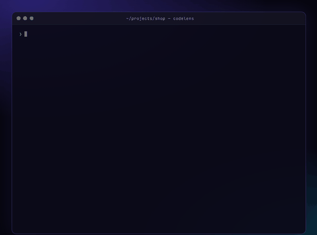
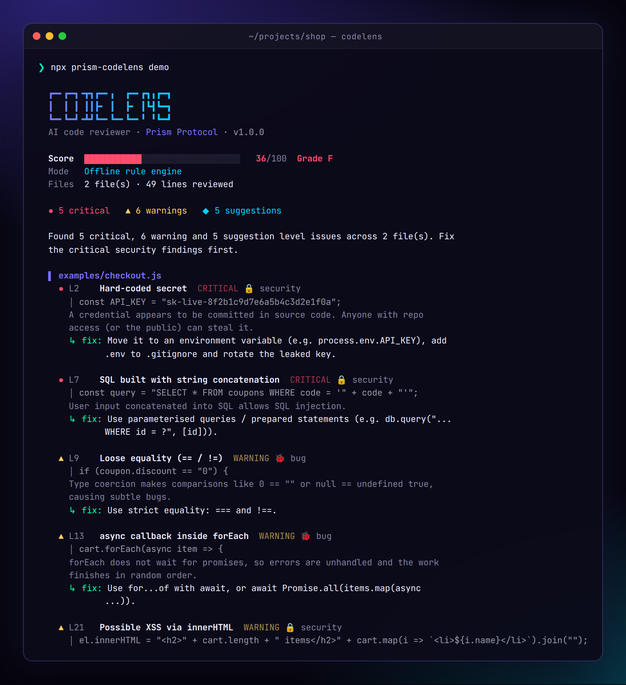
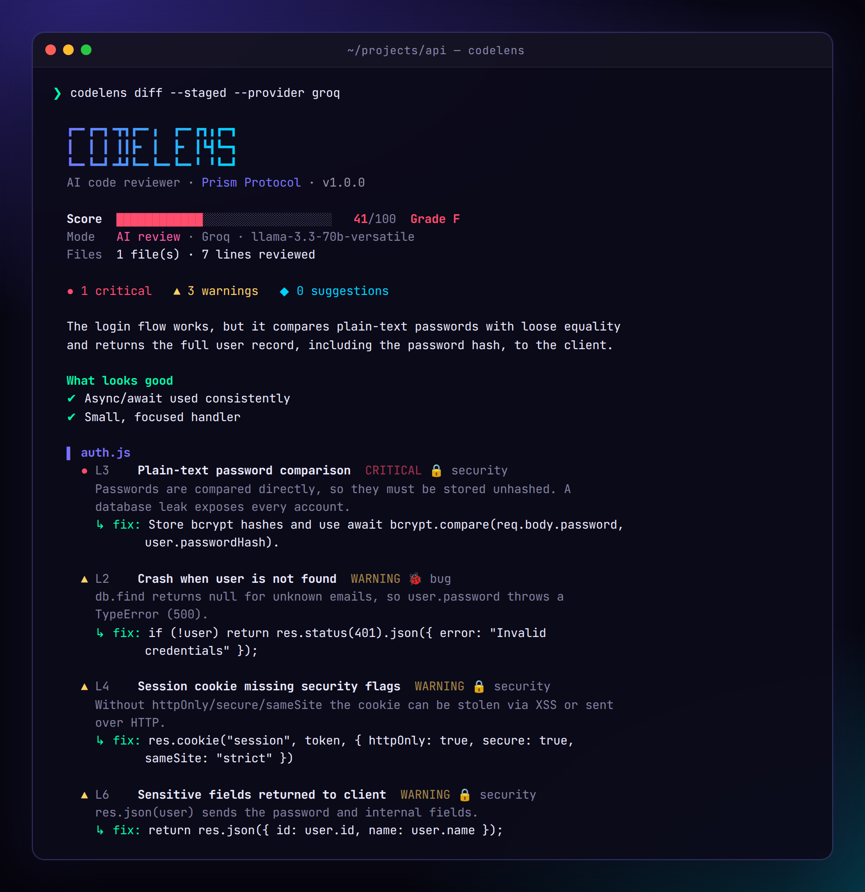
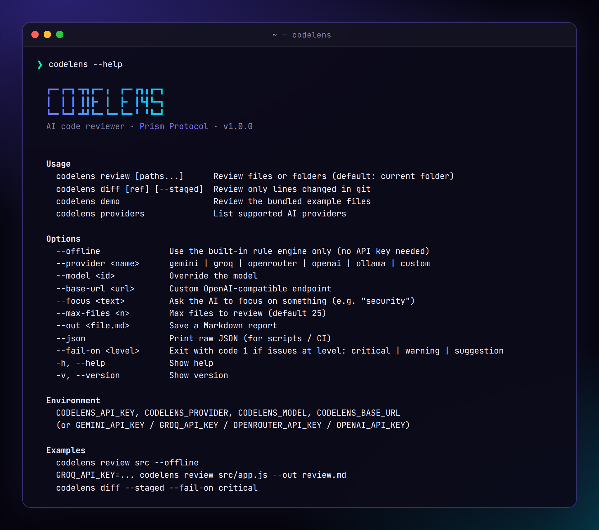
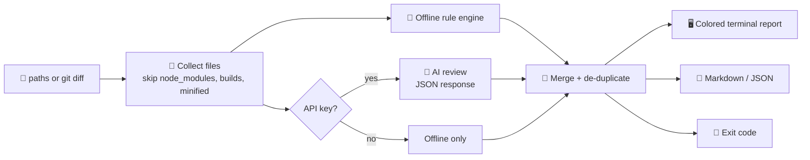

<!-- ═════════════ HEADER ═════════════ -->
<p align="center">
  
</p>

<p align="center">
  
</p>

<p align="center">
  <a href="https://github.com/krishyaa06/prism-codelens/actions/workflows/ci.yml"></a>
  
  
  
  <a href="LICENSE"></a>
</p>

<p align="center">
  
</p>


## ⚡ Overview

**Prism CodeLens** reviews your code right from the terminal. Point it at a file, a folder or your git changes and it finds **security holes, bugs and code smells**, explains each one, suggests a fix, gives your code a **score from 0 to 100** and can export a clean **Markdown report**.

- 🧠 **AI mode.** Uses Gemini, Groq, OpenRouter, OpenAI, a local Ollama model or any OpenAI-compatible API
- 🔌 **Offline mode.** A built-in rule engine with 17 rules works with no key and no internet
- 🧬 **Best of both.** In AI mode the offline findings are merged in, so obvious problems are never missed
- 🔀 **Git aware.** `codelens diff` reviews only the lines you changed, perfect before a commit or PR
- 🚦 **CI ready.** `--json` and `--fail-on` turn it into a quality gate
- 📦 **Zero dependencies.** Plain Node.js, nothing to install except the tool itself

## 📸 Screenshots

<p align="center"><br><sub><b>codelens demo</b>: offline review of the bundled example files</sub></p>

<table>
  <tr>
    <td width="50%"><p align="center"><b>AI review</b> (example output, rendered with a sample model response)</p></td>
    <td width="50%"><p align="center"><b>codelens --help</b></p></td>
  </tr>
</table>

## 🚀 Install

```bash
# Option 1: clone and link (gives you the `codelens` command)
git clone https://github.com/krishyaa06/prism-codelens.git
cd prism-codelens
npm link

# Option 2: run straight from GitHub
npx github:krishyaa06/prism-codelens demo
```

Requires **Node.js 18.17 or newer**. Try it instantly with no key:

```bash
codelens demo
```

## 🧩 Usage

```bash
codelens review                       # review the current folder
codelens review src app.py --offline  # specific paths, rule engine only
codelens review src --focus security  # ask the AI to focus on something
codelens review src --out review.md   # save a Markdown report
codelens diff                         # only lines changed vs HEAD
codelens diff main                    # only lines changed vs a branch
codelens diff --staged --fail-on critical
codelens providers                    # list AI providers
```

### Commands

| Command | Description |
|---------|-------------|
| `review [paths...]` | Review files or folders (default: current folder) |
| `diff [ref] [--staged]` | Review only lines changed in git (vs `HEAD`, a ref or the staging area) |
| `demo` | Review the bundled example files (offline unless you pass `--provider`) |
| `providers` | List supported AI providers and their default models |

### Options

| Flag | Description |
|------|-------------|
| `--offline` | Use the built-in rule engine only |
| `--provider <name>` | `gemini` · `groq` · `openrouter` · `openai` · `ollama` · `custom` |
| `--model <id>` | Override the model |
| `--base-url <url>` | Custom OpenAI-compatible endpoint |
| `--api-key <key>` | Pass a key directly (env vars are safer) |
| `--focus <text>` | Extra instruction for the AI, e.g. `"performance"` |
| `--max-files <n>` | Max files to review (default 25) |
| `--out <file.md>` | Save a Markdown report |
| `--json` | Print raw JSON for scripts and CI |
| `--fail-on <level>` | Exit with code 1 if there are issues at `critical`, `warning` or `suggestion` level |
| `-h`, `--help` / `-v`, `--version` | Help and version |

## 🤖 AI Providers

| Provider | Default model | Key env var | Free tier |
|----------|---------------|-------------|:---------:|
| `gemini` | `gemini-2.5-flash` | `GEMINI_API_KEY` | ✅ [aistudio.google.com](https://aistudio.google.com/apikey) |
| `groq` | `llama-3.3-70b-versatile` | `GROQ_API_KEY` | ✅ [console.groq.com](https://console.groq.com/keys) |
| `openrouter` | `meta-llama/llama-3.3-70b-instruct:free` | `OPENROUTER_API_KEY` | ✅ [openrouter.ai](https://openrouter.ai/keys) |
| `openai` | `gpt-4o-mini` | `OPENAI_API_KEY` | |
| `ollama` | `qwen2.5-coder` | none (runs locally) | ✅ |
| `custom` | your choice | `CODELENS_API_KEY` + `--base-url` | |

You can also use the generic variables `CODELENS_API_KEY`, `CODELENS_PROVIDER`, `CODELENS_MODEL` and `CODELENS_BASE_URL`.
If only `CODELENS_API_KEY` is set, the provider is detected from the key format (`gsk_` → Groq, `sk-or-` → OpenRouter, `sk-` → OpenAI, otherwise Gemini).
If no key is found at all, CodeLens falls back to the offline engine and tells you so.

```bash
export GROQ_API_KEY=your_key
codelens review src
```

## 🔍 Offline Rules

| Rule | Severity | Catches |
|------|:--------:|---------|
| `hardcoded-secret` | 🔴 critical | Passwords, API keys and tokens written in code |
| `known-token-format` | 🔴 critical | OpenAI, GitHub, Google, Slack and Discord token patterns |
| `eval` | 🔴 critical | `eval()` / `exec()` calls |
| `sql-concat` | 🔴 critical | SQL built with string concatenation or templates |
| `innerhtml` | 🟠 warning | Unescaped `innerHTML` (XSS risk) |
| `loose-equality` | 🟠 warning | `==` / `!=` instead of `===` / `!==` |
| `empty-catch` | 🟠 warning | Errors silently swallowed |
| `bare-except` | 🟠 warning | Python `except:` with no type |
| `http-url` | 🟠 warning | Insecure `http://` URLs (localhost and XML namespaces are ignored) |
| `async-foreach` | 🟠 warning | `async` callbacks inside `forEach` |
| `var` | 🔵 suggestion | `var` instead of `let` / `const` |
| `console-log` | 🔵 suggestion | Leftover `console.log` (CLI files are skipped) |
| `print-debug` | 🔵 suggestion | Leftover Python `print()` debugging |
| `todo` | 🔵 suggestion | `TODO` / `FIXME` / `HACK` / `XXX` comments |
| `parseint-radix` | 🔵 suggestion | `parseInt` without a radix |
| `long-line` | 🔵 suggestion | Lines over 180 characters |
| `long-function` | 🔵 suggestion | Functions longer than 60 lines |

Silence a finding on purpose with a comment:

```js
const html = trustedTemplate; el.innerHTML = html; // codelens-ignore
// codelens-ignore-next-line
eval(sandboxedCode);
```

**Languages:** JavaScript, TypeScript, Python, Java, Kotlin, Go, Rust, Ruby, PHP, C, C++, C#, Swift, Dart, Solidity, Shell, SQL, HTML, CSS/SCSS, Vue and Svelte. `node_modules`, build folders, hidden folders, minified files, lock files and files over 200 KB are skipped.

## 🧮 Scoring

Each issue has a weight (critical 15, warning 6, suggestion 2) and the penalty is scaled by how many lines were reviewed, so a big project is not punished just for being big.

| Score | Grade |
|:-----:|:-----:|
| 90 to 100 | A+ |
| 80 to 89 | A |
| 70 to 79 | B |
| 60 to 69 | C |
| 45 to 59 | D |
| below 45 | F |

Code with any **critical** finding is capped (69 in offline mode, 60 when merged with an AI review), so a security hole can never get an A.

## 🔄 How it works



## 🚦 Use in CI

Exit codes: **0** = ok, **1** = issues found at the `--fail-on` level, **2** = error (bad arguments, network, etc.).

```yaml
# .github/workflows/codelens.yml
name: CodeLens
on: [pull_request]
jobs:
  review:
    runs-on: ubuntu-latest
    steps:
      - uses: actions/checkout@v4
        with: { fetch-depth: 0 }
      - uses: actions/setup-node@v4
        with: { node-version: 20 }
      - run: npx github:krishyaa06/prism-codelens diff origin/${{ github.base_ref }} --fail-on critical --out codelens.md
        env:
          GROQ_API_KEY: ${{ secrets.GROQ_API_KEY }}   # optional, runs offline without it
```

This repo dogfoods itself: its own [CI](.github/workflows/ci.yml) runs the tests on Node 20 and 22 and then runs `codelens review src bin --offline --fail-on warning`.

## 📁 Project Structure

```
prism-codelens/
├── bin/codelens.js     # executable entry
├── src/
│   ├── cli.js          # argument parsing, commands, exit codes
│   ├── collect.js      # file walker + git diff parser
│   ├── rules.js        # 17 offline rules + scoring
│   ├── providers.js    # provider presets + chat client
│   ├── review.js       # AI prompt, response parsing, merge
│   ├── render.js       # colored terminal output
│   ├── report.js       # Markdown report
│   ├── colors.js
│   └── index.js        # programmatic API
├── examples/           # intentionally buggy files for the demo
├── test/codelens.test.js
└── .github/workflows/ci.yml
```

> The files in `examples/` contain fake secrets and bad patterns on purpose. They are not real keys.

## 🧪 Testing

```bash
npm test          # rules, scoring, ignore comments, diff parsing, providers, CLI, Markdown
npm run demo      # offline review of examples/
```

## 🗺️ Roadmap

- [x] Offline rule engine + AI review merge
- [x] Git diff mode, Markdown and JSON output
- [x] CI quality gate
- [ ] Post review comments directly on GitHub PRs
- [ ] `.codelensrc` config file for rules and thresholds
- [ ] Auto-fix for simple rules
- [ ] VS Code extension

## 🤝 Contributing

1. Fork the repo
2. Create a branch: `git checkout -b feature/new-rule`
3. Add your rule in `src/rules.js` with a test in `test/codelens.test.js`
4. Run `npm test` and open a Pull Request

## 👤 Author

<table>
  <tr>
    <td align="center">
      <a href="https://github.com/krishyaa06"><br><b>Soumya Bhandare</b></a><br>
      <sub>Founder @ Prism Protocol</sub>
    </td>
    <td>
      <a href="https://dc.gg/prismprotocol"></a><br>
      <a href="https://instagram.com/prism_protocol_"></a><br>
      <a href="https://x.com/krishyaa06"></a>
    </td>
  </tr>
</table>

## 📄 License

Released under the [MIT License](LICENSE).

<p align="center">
  <b>If you like this project, consider giving it a ⭐</b><br>
  <sub>"Build. Create. Compete." · Made with ⚡ by Prism Protocol</sub>
</p>


